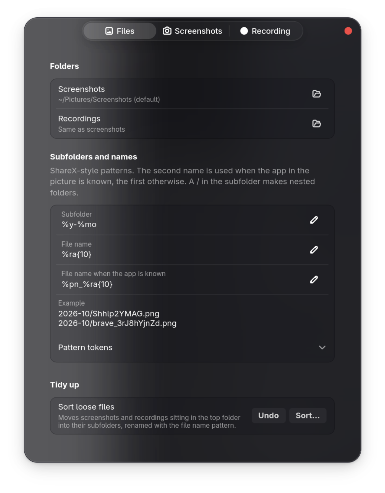
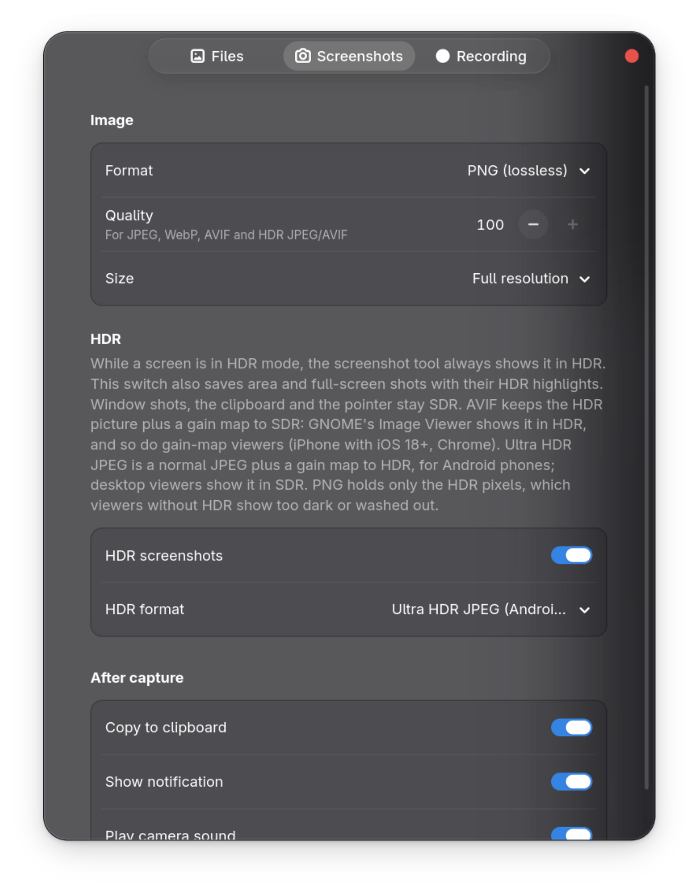
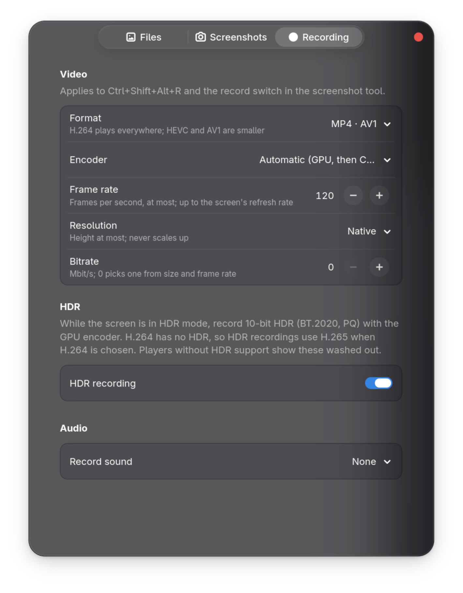
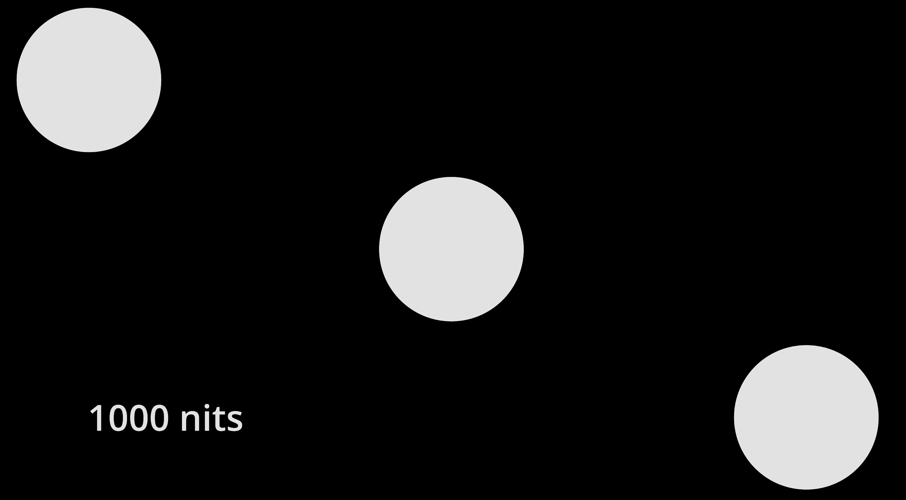

# Screenshot Plus

An extension for GNOME screenshot and screen record.

> [!NOTE]
>
> This app is **completely** generated from AI and is **only** intended for me. Tested on Fedora, Gnome, Wayland only. I won't add support for **any file managers**, **any window manager**, **any display server**.

Read all technical aspects here: [DOCS.md](./DOCS.md)
<br>
Read all Claude findings here: [readme-claude.md](./readme-claude.md)

## Functions

### Files

- Screenshot / Recording folders
- Subfolders and file names using templates
- Tidy up for existing loose files (tested on GNOME only)

### Screenshots

- Formats: PNG (lossless), JPEG, WebP, AVIF
- Quality (for JPEG, WebP, AVIF, HDR JPEG/AVIF)
- Size / Resolution
- After capture behaviours: Copy to clipboard, Show notification, Play sound

### Recording

- Formats: MP4(H264, H265, AV1), WebM(VP9)
- Encoders: GPU(VA-API), CPU, Automatic(CPU / GPU)
- Frame rate
- Resolutions: Native, 480-2160p
- Bitrate
- Record sounds: System, Mic, Both, None

### HDR support
> [!NOTE]
>
> HDR is super unstable. Not cross compatible for images (gain maps, sdr/hdr base image), causes video to slutter for videos (unstable fps). I had turned them off, and plan to remove those features in the future.

- Screenshot: Ultra HDR(Google Photos), PNG 16-bit PQ, AVIF with gain map
- Recording: BT.2020, PQ (except H264)

## Screenshots

Files Tab



Screenshots Tab



Recording Tab



1000 nits test. Credit: [Youtube](https://www.youtube.com/watch?v=TlmD_-Hwzp8)

Image (Ultra HDR, Chromium based browsers only)


[Video (raw)](docs/1000nits.mp4), [Youtube](https://youtu.be/WyVxgeCQhj0)


## Installation
Download [this repo](https://github.com/du-cc/screenshot-plus/archive/refs/heads/main.zip) as zip and run:
```bash
gnome-extensions install screenshot-plus-main.zip [--force]
```

## Development
### AI

Everything. I only prompt and test bugs.

## Known issues (all HDR related, won't fix)
- HDR causes stutter and unstable fps in recording.
- Blur glitch in Ultra HDR screenshots
- Window capture mode doesn't do HDR captures.